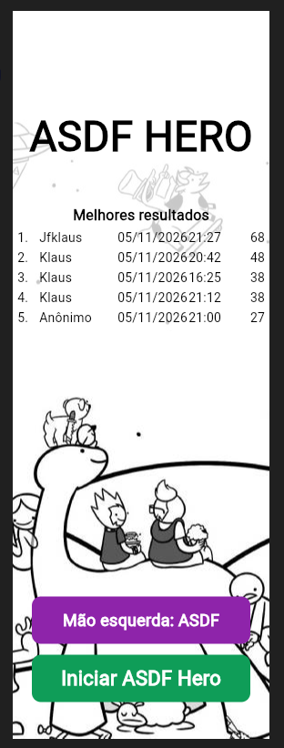
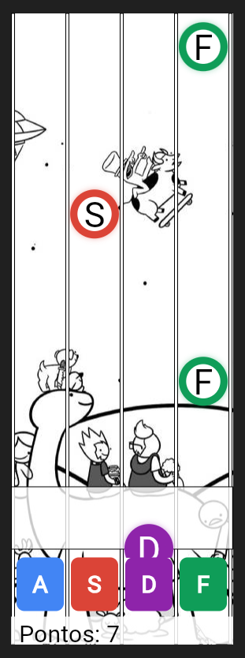
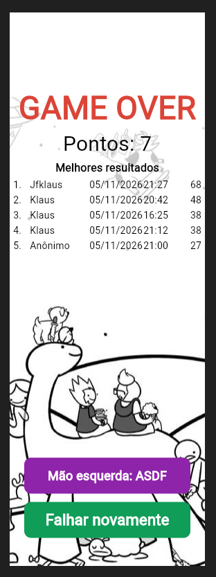

## processing-asdf-game
### What is this project:
Project developed as an activity at Feevale University in the field of Computer Graphics.





### How to play
On the start page (and on the game over page), choose the hand with the button
below **Iniciar ASDF Hero** / **Falhar novamente**:

| Hand | Keys (one for each lane, from left to right) |
| --- | --- |
| Left (default) | `A` `S` `D` `F` |
| Right | `J` `K` `L` `Ç` (on US keyboards the `Ç` key is `;`, it works too) |

The examples below use the left hand keys.

**Phone / tablet:** below the action bar there are 4 touch buttons, one for
each lane, with the color of the lane and its key. A touch on a button works
like its key, and a key pressed on the keyboard shows the press effect on its
button (like the action bar). The letters hide behind the buttons. On small
screens the game is made smaller to fit the page (it is never made bigger than
its size).

Letters (`A`, `S`, `D`, `F`) fall down four lanes. Press the matching key while
the letter touches the white action bar to score a point (from the moment the
circle touches the bar until it fully leaves it). Several letters
fall one after the other. The game starts slow; the more points you have, the
faster the letters fall and the closer they get to each other. After 25 points
the letters no longer match their lane.

**Gold letter (from 40 points):** after a random number of letters (between 5
and 10), a surprise gold letter falls **twice as fast** as the others, on its
own, between the normal letters. It must be pressed like any other letter
(missing it ends the game) and gives `GOLD_POINTS` points (1 by default). It can pass a normal letter, so
sometimes there are two letters in the action bar: each key press hits one
letter (the lowest one with that char).

**Swap (from 50 points):** after a random number of letters (between 5 and
10), a letter that looks normal swaps its char with the next letter when it is
close to the action bar (150 px). Example: `A` (close to the bar) and `F` (the
next one) -> the first letter shows `F` and the next shows `A`. Both letters
turn **silver**, and you must press the new chars. Only the chars change, the
letters stay in their lanes.

When you press `A`, `S`, `D` or `F` the action bar gets 2 px bigger on each
side for a moment and blinks:
- **light yellow**: right press (the letter of that key is in the action bar);
- **light red**: wrong press, the game is over (the red stays during the slow
  motion, so you can see why the game ended).

The game is over when:
- a letter leaves the action bar without being pressed, or
- you press `A`, `S`, `D` or `F` at the wrong moment: the letter of that key
  is not in the action bar (too early, too late, or another letter is there).

The game over page shows your points and, below them, the **5 best results**
(position, date, time and points). The result of the game that just ended is
in **bold**. The results are kept in memory while the server runs (they are
shared by all the browser tabs, and they are lost when the server stops).

Pressing the same letter again while it is still in the action bar is ignored.
Other keys (arrows, space, other letters...) and keys on the start / game over
pages are ignored too.

---

## Project structure
```
processing-asdf-game/
├── pyproject.toml               # project, dependencies, pytest / coverage / Flet settings
├── requirements-dev.txt         # all the packages to run, test and build
├── README.md
├── docs/                        # screenshots used by this README
├── src/
│   ├── main.py                  # entry point: starts the Flet web server
│   ├── assets/                  # Flet assets (background image)
│   └── asdf_hero/
│       ├── config.py            # ALL game settings (sizes, speeds, level, timings)
│       ├── app.py               # Flet app: game loop (input -> update -> render)
│       ├── game/                # game rules, no Flet
│       │   ├── challenges/      #   surprises after some points
│       │   │   ├── base.py      #     Challenge (hooks) + ChallengeSchedule (5-10 letters)
│       │   │   ├── gold.py      #     gold letter (faster)
│       │   │   └── swap.py      #     two letters swap their chars (silver)
│       │   ├── states.py        #   GamePage, Hand, LetterStatus, Highlight (enums)
│       │   ├── game.py          #   Game: pages, points, letters, game over
│       │   ├── letter.py        #   Letter: movement and status
│       │   ├── action_bar.py    #   ActionBar: hit area and highlight
│       │   ├── button.py        #   Button: clickable area
│       │   ├── scoreboard.py    #   Scoreboard: the 5 best results (in memory)
│       │   └── level.py         #   speed / distance by points
│       └── ui/                  # Flet views, no game rules
│           ├── theme.py         #   colors, font sizes and texts
│           ├── game_view.py     #   GameView: the whole screen
│           ├── letter_view.py
│           ├── action_bar_view.py
│           ├── background_view.py
│           ├── button_view.py
│           ├── scoreboard_view.py   #   the 5 best results
│           ├── touch_buttons_view.py   #   the 4 touch buttons (phone)
│           └── press_effect.py  #   press effect (action bar and touch buttons)
└── tests/                       # one responsibility per file (see "Tests")
    ├── conftest.py              # shared fixtures
    ├── helpers.py               # shared helpers (perfect player, frames...)
    ├── game/                    # rules
    ├── ui/                      # views
    └── app/                     # Flet app and entry point
```

### How it works
- **Game loop** (`asdf_hero/app.py`): 60 times per second, `GameApp.frame()`
  does the classic game loop: **input** (queued keys / clicks) →
  **update** (`Game.update()`) → **render** (`GameView.render()`). Then
  `page.update()` sends only the changes to the browser (nothing is sent
  when nothing changes).
- **Rules** (`asdf_hero/game`): plain Python, no Flet. `Game` keeps the state
  (page, points, letters, level) and the input methods (`key_pressed`,
  `mouse_pressed`, `mouse_released`).
- **Views** (`asdf_hero/ui`): each view owns Flet controls and `render()`
  copies the state of the game to them (position, colors, visibility, texts).
- Each browser tab gets its own `GameApp`, `Game` and `GameView`. The loop
  pauses while the tab is hidden or disconnected and stops when the session
  is closed.

---

## Setting up and running the game (Flet, in the browser)
Requirements: **Python 3.10+**.

### 1. Create a virtual environment
From inside the `processing-asdf-game` folder:

Linux / macOS:
```bash
python3 -m venv .venv
source .venv/bin/activate
```

Windows (PowerShell):
```powershell
py -3 -m venv .venv
.venv\Scripts\Activate.ps1
```

Windows (Git Bash):
```bash
py -3 -m venv .venv
source .venv/Scripts/activate
```

### 2. Install
```bash
pip install -r requirements-dev.txt
```
This installs everything to **run**, **test** and **build** the game:

| Package | For |
| --- | --- |
| `flet` | The game (and the mobile app) |
| `flet-web` (`flet[web]`) | The web server: `python src/main.py` |
| `flet-cli` (`flet[cli]`) | The `flet` command: `flet build`, `flet debug` |
| `pytest`, `pytest-cov` | The tests and the coverage |

The mobile build also needs tools that are not Python packages (Flutter,
Java, Android SDK / Xcode): see [Build a mobile app](#build-a-mobile-app-android--ios).

The same packages are in `pyproject.toml`, as extras, if you prefer to install
the project as a package:

| Install | What you get |
| --- | --- |
| `pip install -e ".[dev,build]"` | The same as `requirements-dev.txt` |
| `pip install -e ".[dev]"` | Play in the browser + run the tests |
| `pip install -e ".[web]"` | Only play in the browser |
| `pip install -e ".[build]"` | The `flet` command, to build the mobile app |

`tests/test_requirements.py` checks that `requirements-dev.txt` and
`pyproject.toml` have the same packages: change both when you add a package.

### 3. Start the game
```bash
python src/main.py
```
The browser opens at <http://127.0.0.1:8550>. Click **Iniciar ASDF Hero** and
play with the `A`, `S`, `D`, `F` keys. Stop the server with `Ctrl+C`.

| Environment variable | Default | What it does |
| --- | --- | --- |
| `FLET_SERVER_PORT` | `8550` | Port of the web server |
| `FLET_SERVER_IP` | `127.0.0.1` | IP the server listens on (`0.0.0.0` to play from other devices on the network) |

Example: `FLET_SERVER_IP=0.0.0.0 FLET_SERVER_PORT=8080 python src/main.py`

### Play on a phone
1. Start the server so other devices on the network can open it:
   `FLET_SERVER_IP=0.0.0.0 python src/main.py`
   (Windows PowerShell: `$env:FLET_SERVER_IP="0.0.0.0"; python src/main.py`).
2. Find the IP of the computer (`ipconfig` on Windows, `ip addr` on Linux,
   `ipconfig getifaddr en0` on macOS).
3. On the phone (same Wi-Fi), open `http://<computer IP>:8550` and play with
   the touch buttons. The firewall of the computer must allow the port 8550.

### Tuning the game
All the numbers of the game are in `src/asdf_hero/config.py`, and the colors
and texts are in `src/asdf_hero/ui/theme.py`.

The game level depends on the points. It goes from the initial level (0
points) to the max level (max speed at 75 points, min distance at 100 points):

| Setting | Constant (`config.py`) | Value | Effect |
| --- | --- | --- | --- |
| Initial speed | `INIT_SPEED` | `3` px per frame (180 px/s) | Speed at the start of a game |
| Max speed | `MAX_SPEED` | `4.5` px per frame (270 px/s) | Fastest speed |
| Speed step | `SPEED_STEP_BY_POINT` | `0.02` px per point | Bigger = gets fast sooner |
| Initial distance | `INIT_DISTANCE` | `150` px | Space between letters at the start |
| Min distance | `MIN_DISTANCE` | `100` px | Smallest space between letters |
| Distance step | `DISTANCE_STEP_BY_POINT` | `0.5` px per point | Bigger = letters get closer sooner |
| Highlight | `HIGHLIGHT_FRAMES` | `12` frames (0.2 s) | How long the action bar blinks |
| Action bar | `ACTION_BAR_TOP` / `ACTION_BAR_HEIGHT` | `600` / `80` px | A letter can be pressed while its circle touches the bar (hit area of 142 px) |
| Slow motion | `SLOW_MOTION_STEPS` / `SLOW_MOTION_STEP_FRAMES` | `13` / `12` | Game over transition (~2.8 s) |
| Gold letter | `GOLD_FROM_POINTS` | `40` | Points to start the gold letters |
| Gold frequency | `GOLD_EVERY_MIN_LETTERS` / `GOLD_EVERY_MAX_LETTERS` | `5` / `10` | Random number of normal letters before each gold letter |
| Gold speed | `GOLD_SPEED_FACTOR` | `2.0` | Gold speed = game speed x this (456 px/s at 40 points, 540 px/s at the max level) |
| Gold points | `GOLD_POINTS` | `1` | Points for a gold letter (more points also make the game faster) |
| Swap | `SWAP_FROM_POINTS` | `50` | Points to start the swap challenge |
| Swap frequency | `SWAP_EVERY_MIN_LETTERS` / `SWAP_EVERY_MAX_LETTERS` | `5` / `10` | Random number of normal letters before each swap |
| Swap distance | `SWAP_DISTANCE` | `150` px | The letters swap when the circle is this far from the action bar (0.56 s to react at the max speed) |
| Swap points | `SWAP_POINTS` | `1` | Points for a silver (swapped) letter |
| Best results | `SCOREBOARD_SIZE` | `5` | Number of best results on the game over page |
| Touch buttons | `TOUCH_BUTTONS_TOP` / `TOUCH_BUTTON_HEIGHT` / `TOUCH_BUTTON_MARGIN` | `690` / `68` / `2` px | Position and size of the touch buttons (60 x 68 px) |
| Keys | `LEFT_HAND_KEYS` / `RIGHT_HAND_KEYS` | `ASDF` / `JKLÇ` | Keys of each hand (one for each lane) |
| Key names | `KEY_ALIASES` | `{";": "Ç"}` | Other names of the same key |

In `ui/theme.py`: the press effect of the action bar and of the touch buttons
is `PRESS_EFFECT_GROW` (2 px bigger on each side) for `PRESS_EFFECT_FRAMES`
frames (8 = 0.13 s),
the colors of the challenges are `GOLD_COLOR` / `GOLD_GLOW_COLOR` and
`SILVER_COLOR` / `SILVER_GLOW_COLOR`, the texts of the hand button are
`HAND_BUTTON_TEXTS`, and the best results use `SCOREBOARD_DATE_FORMAT`
(`dd/mm/yyyy`) and `SCOREBOARD_TIME_FORMAT` (`HH:MM`). The touch buttons use
`TOUCH_BUTTON_FONT_SIZE`, `TOUCH_BUTTON_RADIUS` and
`TOUCH_BUTTON_PRESSED_OPACITY` (the button is lighter during the press
effect).

To add a new challenge: create a `Challenge` subclass in
`game/challenges/` (with a `ChallengeSchedule`), and add it to
`Game.challenges`.

The normal letters move at the game speed, so they never overlap. The gold
letter avoids the lanes of the letters that are still coming, so it does not
fall on top of them.
`FPS` (60) also changes the speed, because the speed is in pixels per frame.

With these values, a perfect player sees:

| Time | Points | Speed | New letter every |
| --- | --- | --- | --- |
| 0 s | 0 | 180 px/s | 1.2 s |
| 30 s | ~26 | 211 px/s | 0.9 s |
| 60 s | ~64 | 257 px/s | 0.7 s |
| 90 s | ~116 (max level) | 270 px/s | 0.6 s |

The max level is kept moderate on purpose, so new challenges can be added
later. A new game always starts at the initial level. There is never more than
one normal letter inside the action bar at the same time. `TestLevelDesign` in
`tests/game/test_level.py` checks these rules, so update it if the design
changes.

---

## Build a mobile app (Android / iOS)
The same code can be built as an app that is installed on the phone. Inside
the app Python runs on the phone: no server, no network. The game uses the
touch buttons and fits the screen. Flet builds the app with
[`flet build`](https://flet.dev/docs/publish) (Flutter).

### What is needed
| To build | Computer | Tools |
| --- | --- | --- |
| Android (`apk`, `aab`) | Windows, macOS or Linux | Installed by `flet build` on the first build (Flutter SDK, Java JDK and Android SDK: a few GB) |
| iOS (`ipa`, `ios-simulator`) | macOS only | Xcode (from the App Store); an Apple Developer account to install on a real iPhone |

The `flet` command is installed by `requirements-dev.txt` (or
`pip install -e ".[build]"`).

### 1. Set the app identity (once)
In `pyproject.toml`, `[tool.flet]`:
- `org`: your organization as a reverse domain (`com.example` is only an
  example). The Android package / iOS bundle id is `<org>.<project name>`
  (for example `com.example.asdf_hero`) and must be unique in the stores.
- `product`: the name of the app on the phone (`ASDF Hero`).
- `[project] version`: the version of the app (`1.0.0`).

Optional: put an app icon in `src/assets/icon.png` (square PNG, 1024 x 1024).
Without it, the Flet icon is used.

### 2. Build
From the project folder (`flet build` reads `pyproject.toml`: the app is in
`src/`, the entry point is `src/main.py`):

```bash
flet build apk      # Android: .apk file to install on a phone
flet build aab      # Android: .aab file for the Google Play Store
flet build ipa      # iOS (macOS only): .ipa file
```
The first build asks to install the Flutter SDK (answer `y`, or use
`flet build apk --yes`) and takes a while; the next builds are faster. The
result is in `build/apk/` (or `build/aab/`, `build/ipa/`).

Only the packages of `[project] dependencies` (Flet) go into the app: the
web server and the test tools are extras, so the app stays small.

### 3. Install the APK on an Android phone
- With a USB cable (USB debugging on): `adb install build/apk/app-release.apk`
  (`adb` is in the Android SDK, in `platform-tools`), or
- copy the `.apk` file to the phone and open it (allow "install unknown apps").

### Test on a phone while developing
- In the phone browser (no build): see [Play on a phone](#play-on-a-phone).
- As an app, on a phone connected with USB: `flet debug android`
  (or `flet debug ios` on macOS).

### Good to know
- To publish in the stores the app must be signed: see the `--android-signing-*`
  and `--ios-*` options of `flet build` and the
  [Flet publish guide](https://flet.dev/docs/publish).
- The best results are kept in memory while the app is open (like on the web
  server, they are lost when the app is closed).
- Use the same Flet version in `pyproject.toml` and in the `flet` command
  (1.0.5).

---

## Tests
The tests run with [pytest](https://docs.pytest.org/) and
[pytest-cov](https://pytest-cov.readthedocs.io/) (installed by
`pip install -r requirements-dev.txt`). No browser or Flet server is needed.

```bash
pytest
```

The settings are in `pyproject.toml`: coverage runs automatically and the
run **fails if total coverage is below 90%**. Example output:

```
Name                                  Stmts   Miss  Cover   Missing
-------------------------------------------------------------------
src/asdf_hero/__init__.py                 1      0   100%
src/asdf_hero/app.py                     87      0   100%
src/asdf_hero/config.py                  22      0   100%
...
src/asdf_hero/ui/theme.py                23      0   100%
src/main.py                               6      0   100%
-------------------------------------------------------------------
TOTAL                                   770      0   100%
Required test coverage of 90.0% reached. Total coverage: 100.00%
============================= 313 passed in 3.56s ==============================
```

### Useful commands
| Command | What it does |
| --- | --- |
| `pytest` | Run all tests with coverage (fails below 90%) |
| `pytest tests/game` | Run only the game rules tests (or `tests/ui`, `tests/app`) |
| `pytest -k highlight` | Run the tests whose name matches an expression |
| `pytest -v` | Show the name of each test |
| `pytest --cov-report=html` | Also build an HTML report in `htmlcov/index.html` |
| `pytest --no-cov` | Run the tests without coverage (faster) |

### How the tests work
Each test file has one responsibility:

| File | What it checks |
| --- | --- |
| **`tests/game/`** | **Game rules (no Flet)** |
| `test_architecture.py` | The rules do not import Flet or the views |
| `test_design_rules.py` | The agreed design limits in `config.py` (speeds, gold, one letter in the bar...) |
| `test_level.py` | Speed and distance by points |
| `test_action_bar.py` | Hit area of the bar and its highlight |
| `test_button.py` | Clickable area of a button |
| `test_keys.py` | Keys of each hand and key names (`;` = `Ç`) |
| `test_letter.py` | A letter: fall, status, key press |
| `test_pages.py` | Start, game over and retry; a new game is clean |
| `test_hand.py` | Hand choice (start and game over pages) |
| `test_letter_flow.py` | New letters, spacing, movement, removal |
| `test_key_press.py` | Result of a key press: points, game over, yellow / red bar |
| `test_game_over.py` | Missed letter, the slow motion, the result goes to the scoreboard |
| `test_scoreboard.py` | Best results: order, only the best 5, same points |
| `test_challenge_base.py` | Challenge hooks and the schedule (from N points, after 5-10 letters) |
| `test_gold_schedule.py` | When and where the gold letter appears |
| `test_gold_letter.py` | Gold letter: speed, points, game over |
| `test_swap.py` | Swap challenge: when, which letters, new chars, silver |
| `test_touch_buttons.py` | Touch buttons: one in each lane, each one is the key of its lane, keys press their button |
| `test_full_game.py` | Whole games with a perfect player |
| **`tests/ui/`** | **Flet views** |
| `test_theme.py` | Color helper and the rules of colors / texts |
| `test_letter_view.py` | Circles, char, colors of each status, gold / silver glow |
| `test_action_bar_view.py` | Bar color and its press effect (also during the slow motion) |
| `test_button_view.py` | A button |
| `test_background_view.py` | Lanes and the game over banner |
| `test_game_view.py` | Layers and what each page shows (texts, buttons, best results position) |
| `test_scoreboard_view.py` | Best results: position, date, time, points, last game in bold |
| `test_touch_buttons_view.py` | Touch buttons: lane colors, keys, press effect |
| `test_press_effect.py` | Press effect: 2 px bigger for some frames after each press |
| `test_game_view_letters.py` | One view for each letter (kept, removed, gold on top, hidden behind the buttons) |
| **`tests/app/`** | **Flet app** |
| `test_page_setup.py` | Page settings, events, `main()`, best results shared by all tabs |
| `test_input.py` | Keys / clicks are queued and applied by the game loop |
| `test_game_loop.py` | Frame order (input -> update -> render), frame rate, slow frames, errors |
| `test_lifecycle.py` | Tab connect / disconnect (pause) / close (stop) |
| `test_screen_fit.py` | The game is made smaller to fit small pages (phones) |
| `test_main.py` | `python src/main.py` (server settings, assets) |
| **`tests/`** | **Project** |
| `test_requirements.py` | `requirements-dev.txt` has the same packages as `pyproject.toml` |

- **Rules without mocks:** `Game` receives the random generator (`rng`), so
  the tests choose the lanes with `scripted_rng([...])` and put letters where
  they want with the `place_letter` fixture (`tests/conftest.py`).
- **Views:** the Flet controls are plain Python objects, so the tests check
  their properties (`visible`, `top`, `bgcolor`, `content.value`...).
- **Game loop timing** is tested with a `FakeClock` (`tests/app/fakes.py`)
  that only moves when the loop sleeps or a frame takes time. Real clocks are
  different on each OS (on Windows the asyncio clock moves in steps of
  ~15.6 ms), so these tests give the same result on Windows, Linux and macOS.
- Flet controls with the same values are equal (`==`). Check if a control is
  present with `is` (identity), not with `in` / `==`. Letter controls have
  a unique `key` for this reason.
